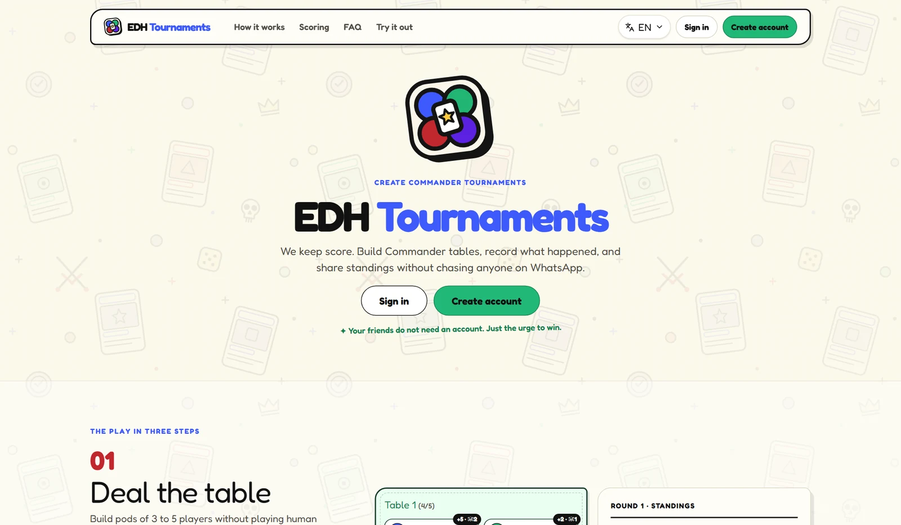
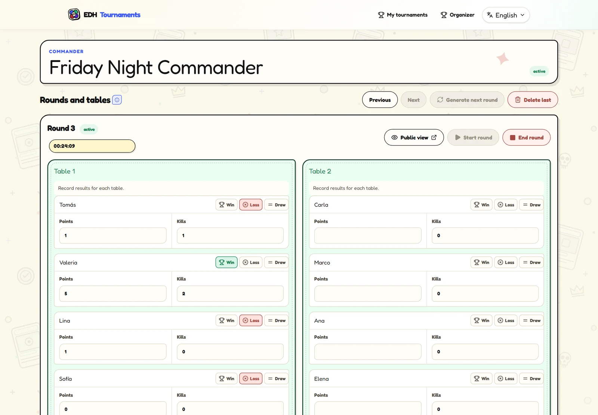
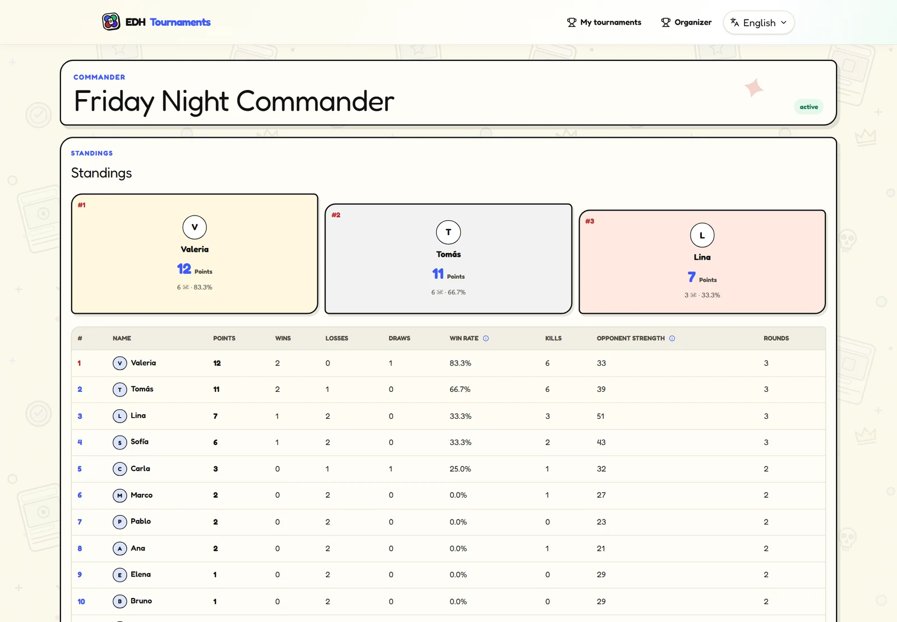

<div align="center">


# EDH Tournaments

**Run multiplayer Commander tournaments without the spreadsheet.**

Pairings, pods, results and live standings in one place, with a public page anyone can follow.

[Live app](https://edh-tournaments.vercel.app) · [Try it without an account](https://edh-tournaments.vercel.app/trial) · [Setup](docs/setup.md)


[](LICENSE)

<br />



</div>

---

## Contents

- [Features](#features)
- [Screenshots](#screenshots)
- [Roles](#roles)
- [Run it locally](#run-it-locally)
- [Project structure](#project-structure)
- [Documentation](#documentation)
- [License](#license)

## Features

### 🏆 For organizers

- **Tournaments** with name, format, number of rounds, player and table limits, and public visibility.
- **Players** can be added manually (no account needed) or linked to a `player` account. Search, rename, retire or remove them before they play.
- **Invitations** through a revocable link, a QR code or a short manual code.
- **Pods of 3 to 5 players.** Pairing avoids repeat opponents first, then groups players with similar scores.
- **Round control**: draft, start, timer, manual table adjustments and removal of the last round.
- **Results per player**: manual points, kills and outcome (win, loss or draw). A round only closes once every table has valid results.
- **Live standings**, ranked by points, opponent strength (the sum of opponents' points), kills and a stable seed.
- **Battle log** with tournament highlights, attendance and tables.

### 🎴 For players

- Join with an invitation link (`/unirse/:token`) or the manual code.
- A personal dashboard with your tournaments and global stats at `/estadisticas`: tournaments, rounds, results, points, kills and podiums.

### 🌐 For everyone

- **Public read-only page** at `/t/:slug` with standings, current round, tables and timer.
- **Trial mode** at `/trial`, no account required.
- Email and password or Google sign-in, password recovery, profile photo, password change and self-service account deletion.
- **Spanish and English** interface.

## Screenshots

<table>
  <tr>
    <td width="50%"></td>
    <td width="50%"></td>
  </tr>
  <tr>
    <td align="center"><b>Rounds</b>: pods, results and the round timer</td>
    <td align="center"><b>Standings</b>: podium and full ranking, updated live</td>
  </tr>
</table>

## Roles

| Role          | Can                                                                                     |
| ------------- | --------------------------------------------------------------------------------------- |
| `player`      | Join tournaments and see their own history.                                             |
| `organizer`   | Create and manage their own tournaments.                                                |
| `admin`       | Browse all data from `/admin`. Cannot create tournaments.                               |
| `super_admin` | Everything `admin` can do, plus manage any tournament, manage users and change roles.   |

New accounts pick `player` or `organizer` on first sign-in. Accounts that arrive through an invitation become `player` automatically. After that, only a `super_admin` can change the role. Permissions are enforced in Supabase (RLS, triggers and functions), not just in the UI.

## Run it locally

```bash
npm install
npm run dev
```

Without Supabase configured, the app runs in demo mode using `localStorage`. For accounts, the database, the Edge Function and deployment, see **[docs/setup.md](docs/setup.md)**.

## Project structure

```text
src/
├── app/          Bootstrapping, routes (AppRouter.tsx) and form limits
├── features/     One folder per screen or area (tournaments, player, admin, landing…)
├── components/   Shared pieces: ui/, layout/ and feedback/
├── domain/       Pure logic: tables, pairing, scoring, statistics and their tests
├── state/        Auth and tournament contexts
├── data/         Supabase repositories
├── lib/          Supabase client and utilities
├── i18n/         Spanish (es.ts) and English (en.ts) strings
└── styles/       Layered CSS, imported in order from index.css
supabase/         Migrations, the admin-users Edge Function and config
docs/             Architecture, design system, decisions, backlog and screenshots
public/           Images, robots.txt and sitemap
```

Imports use the `@/` alias, for example `@/components/ui/button`.

## Documentation

Setup is in English; the rest of the project docs are in Spanish.

| Document                                             | What's inside                                 |
| ---------------------------------------------------- | --------------------------------------------- |
| [docs/setup.md](docs/setup.md)                       | Local setup, Supabase and deployment.         |
| [docs/architecture.md](docs/architecture.md)         | Layers, flows and sources of truth.           |
| [docs/design-system.md](docs/design-system.md)       | Colors, tokens and visual guidelines.         |
| [docs/decisions/](docs/decisions/)                   | Architecture decision records.                |
| [docs/auditoria-visual.md](docs/auditoria-visual.md) | Visual normalization: done and pending.       |
| [docs/pendientes.md](docs/pendientes.md)             | Product backlog.                              |
| [AGENTS.md](AGENTS.md)                               | Rules for coding agents.                      |

## License

[MIT](LICENSE) © 2026 Jocsan Perez C
